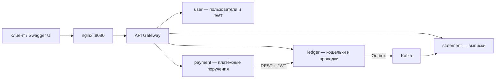

# mini-wallet

Учебный микросервисный backend электронного кошелька: регистрация, пополнение, переводы и история операций.

**Стек:** Java 21 · Spring Boot 4.1 · Spring Security / JWT · PostgreSQL · Flyway · Kafka · Spring Cloud Gateway · nginx · OpenAPI · Docker Compose.

## Возможности

- Регистрация и вход по JWT; доступ к кошелькам, платежам и выпискам своего пользователя.
- Пополнение и переводы в RUB с двойной записью и блокировками кошельков.
- Идемпотентность платежей и денежных операций при повторных запросах.
- Transactional outbox и отдельная модель выписки, обновляемая через Kafka.

## Архитектура



Четыре бизнес-сервиса и gateway — отдельные приложения. В локальном окружении используется один PostgreSQL с отдельной схемой для каждого бизнес-сервиса. Команды выполняются по REST, выписка обновляется асинхронно.

## Запуск

Нужен Docker с Compose и Linux containers. Порты `8080`, `5432` и `9092` должны быть свободны. Java и Maven на компьютере не требуются.

Из корня проекта:

```shell
docker compose up --build -d --wait --wait-timeout 300
```

Откройте **[Swagger UI](http://localhost:8080/swagger-ui.html)**. Сервисы, миграции БД и Kafka-топик подготавливаются автоматически. Первая сборка скачивает образы и зависимости.

Остановка: `docker compose down`. Данные сохраняются в Docker volumes.

## Демонстрация через Swagger

1. **User:** выполните register и login. Скопируйте `accessToken` в **Authorize** без слова `Bearer`.
2. **Ledger:** создайте два кошелька с валютой `RUB`, сохраните их `id` как A и B.
3. **Payment:** выберите пример «Пополнение» и внесите `100.00` на A. Затем по примеру «Перевод» отправьте `25.00` с A на B. Для каждого нового платежа задайте свой `Idempotency-Key`.
4. **Ledger / Statement:** проверьте балансы A = `75.00`, B = `25.00` и выписки по их `walletId`. Записи выписки могут появиться с небольшой задержкой.
5. Повторите перевод с тем же телом и ключом: вернётся прежний платёж, балансы останутся прежними.

## Подробнее

- [HTTP API и авторизация](docs/api.md)
- [Docker, локальная разработка и тесты](docs/docker.md)
- [Архитектурные решения и границы реализации](docs/PROJECT.md)
