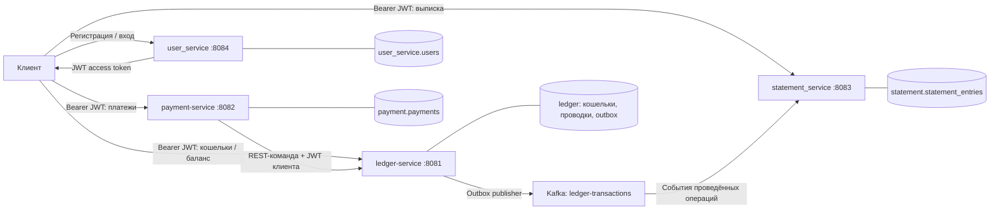

# mini-wallet

Микросервисный backend электронного кошелька на **Java 21 и Spring Boot 4.1.0**. Пользователь регистрируется, получает JWT, создаёт кошельки, пополняет баланс, переводит деньги и просматривает историю операций.

Это учебный пет-проект для практики backend-разработки на задачах платёжной системы: от регистрации и разграничения доступа до двойной записи, конкурентных денежных операций, идемпотентности, transactional outbox и CQRS.

Проект состоит из **четырёх самостоятельных сервисов**. `user_service` отвечает за учётные записи и выдачу токенов, `ledger-service` — за деньги, `payment-service` — за платёжные поручения, `statement_service` — за выписки.

## Содержание

- [Возможности](#возможности)
- [Архитектура](#архитектура)
- [Технологический стек](#технологический-стек)
- [Структура репозитория](#структура-репозитория)
- [Локальный запуск](#локальный-запуск)
- [Регистрация, аутентификация и авторизация](#регистрация-аутентификация-и-авторизация)
- [Денежная модель и надёжность](#денежная-модель-и-надёжность)
- [HTTP API](#http-api)
- [Пример полного сценария](#пример-полного-сценария)
- [События Kafka и выписки](#события-kafka-и-выписки)
- [Конфигурация](#конфигурация)
- [Сборка и тесты](#сборка-и-тесты)
- [Диагностика](#диагностика)
- [Текущие ограничения](#текущие-ограничения)
- [Дальнейшее развитие](#дальнейшее-развитие)
- [Дополнительная документация](#дополнительная-документация)

## Возможности

- Регистрация по email и паролю, хранение хеша пароля и проверка учётных данных через Spring Security.
- Вход с выдачей JWT access token, подписанного RSA-ключом по алгоритму RS256.
- Проверка подписи, issuer и срока действия JWT в каждом сервисе.
- Привязка кошельков и платежей к пользователю из токена; фильтрация выписок по владельцу.
- Создание нескольких кошельков пользователя и получение актуального баланса.
- Пополнение `DEPOSIT` через системный кошелёк и переводы `TRANSFER`.
- Двойная запись: списание и зачисление в одной транзакции PostgreSQL.
- Два уровня идемпотентности: клиент → payment и payment → ledger.
- Пессимистические блокировки кошельков с фиксированным порядком захвата.
- Публикация событий через outbox, построение выписок из Kafka и обработка повторных событий.
- HTTP-ошибки на основе `ProblemDetail` с дополнительным полем `code`.
- Версионирование схем БД через Flyway и открытые health endpoints.

## Архитектура

### Сервисы и границы ответственности

| Сервис / каталог | Порт | Схема PostgreSQL | Ответственность |
| --- | --- | --- | --- |
| `user_service` | `8084` | `user_service` | Регистрация, проверка email и пароля, выдача JWT, данные текущего пользователя из токена |
| `ledger-service` | `8081` | `ledger` | Кошельки, балансы, денежные операции, проводки, outbox |
| `payment-service` | `8082` | `payment` | Приём платёжных поручений, клиентская идемпотентность, синхронный вызов ledger, статусы платежей |
| `statement_service` | `8083` | `statement` | Kafka consumer, read model истории операций, API выписки |

Названия каталогов приведены точно: `user_service` и `statement_service` используют подчёркивание.



В локальной конфигурации сервисы используют **одну БД `miniwallet` с четырьмя отдельными схемами**. Каждый сервис работает со своими таблицами и миграциями; внешних ключей между схемами нет. `userId` передаётся между сервисами как идентификатор, а не как межсервисная связь JPA.

### Как проходит платёж

1. Клиент получает access token в `user_service`.
2. Отправляет поручение в `payment-service` с `Authorization: Bearer ...` и `Idempotency-Key`.
3. Payment проверяет JWT, извлекает пользователя из `sub`, находит или создаёт его платёж.
4. Payment синхронно вызывает `POST /internal/v1/operations` в ledger и передаёт тот же заголовок `Authorization`.
5. Ledger самостоятельно проверяет JWT, принадлежность защищаемого кошелька, статусы кошельков и допустимость операции.
6. В одной транзакции ledger обновляет балансы, сохраняет операцию, две проводки и событие outbox.
7. Payment преобразует HTTP-результат ledger в статус платежа и отвечает клиенту.
8. Outbox publisher отправляет событие в Kafka; statement consumer строит историю операции.

Команды выполняются **синхронно по REST**, чтобы вернуть результат платежа в текущем запросе. Выписка обновляется **асинхронно через Kafka**. Распределённой транзакции между payment и ledger нет; повтор после неопределённого результата опирается на идемпотентность ledger.

## Технологический стек

| Область | Технологии |
| --- | --- |
| Язык и сборка | Java 21, Maven, Maven Wrapper |
| Backend | Spring Boot 4.1.0, Spring MVC, Bean Validation |
| Security | Spring Security, OAuth2 Resource Server, JWT RS256, RSA, `DelegatingPasswordEncoder` |
| Доступ к данным | Spring Data JPA, Hibernate, PostgreSQL 16 |
| Миграции | Flyway; Hibernate запускается с `ddl-auto: validate` |
| Межсервисные команды | Spring `RestClient` с connect/read timeouts |
| События | Apache Kafka, Spring for Apache Kafka, transactional outbox |
| Служебные инструменты | Spring Boot Actuator, Lombok, Jackson |
| Локальная инфраструктура | Docker Compose: PostgreSQL и Kafka в режиме KRaft |
| Тестирование | JUnit, `@SpringBootTest`; сейчас — проверки загрузки контекста |

Версия Spring Boot указана по `pom.xml`. В Compose Kafka использует образ `apache/kafka:latest`, поэтому его версия не зафиксирована.

## Структура репозитория

```text
mini-wallet/
├── README.md
├── docker/
│   └── docker-compose.yaml       # PostgreSQL + Kafka
├── docs/
│   ├── PROJECT.md               # проектные решения и план развития
│   ├── domain.md                # доменная модель
│   ├── rules.md                 # бизнес-правила
│   ├── api.md                   # исходное описание HTTP-контрактов
│   └── events.md                # исходное описание событий
├── user_service/
│   ├── pom.xml
│   ├── mvnw / mvnw.cmd
│   └── src/main/
│       ├── java/.../            # config, entity, repository, security, service, web
│       └── resources/           # application.yaml, keys, db/migration
├── ledger-service/              # кошельки, ledger, outbox publisher
├── payment-service/             # платежи и REST-клиент ledger
└── statement_service/           # Kafka consumer и выписки
```

Каждый сервис — отдельное Spring Boot приложение с собственным `pom.xml`, Maven Wrapper и каталогом `src/test`. **Корневого агрегирующего `pom.xml` нет**: Maven запускается из каталога сервиса либо с `-f <путь к pom.xml>`.

## Локальный запуск

### Требования

- JDK 21 с настроенным `JAVA_HOME`.
- Docker Engine / Docker Desktop с Docker Compose.
- Maven либо Maven Wrapper из каталога нужного сервиса. Wrapper настроен на Maven `3.9.16` и при первом запуске скачивает дистрибутив.
- Свободные порты `5432`, `9092`, `8081`–`8084`.
- Для примера на Bash ниже — `curl` и `jq`; вариант PowerShell использует встроенные HTTP-команды.

Все команды этого раздела, кроме явно указанных переходов `cd`, выполняются **из корня репозитория**. Сервисы запускаются на хосте; Compose поднимает только инфраструктуру.

### 1. Поднять PostgreSQL и Kafka

```shell
docker compose -f docker/docker-compose.yaml up -d
docker compose -f docker/docker-compose.yaml ps
```

| Компонент | Локальный адрес / значение |
| --- | --- |
| PostgreSQL | `localhost:5432` |
| База данных | `miniwallet` |
| Пользователь / пароль БД | `wallet` / `wallet` |
| Kafka bootstrap server | `localhost:9092` |
| Контейнер PostgreSQL | `miniwallet-postgres` |
| Контейнер Kafka | `miniwallet-kafka` |

Дождитесь состояния `healthy` у PostgreSQL и готовности Kafka принимать подключения. Логи инфраструктуры:

```shell
docker compose -f docker/docker-compose.yaml logs -f postgres kafka
```

### 2. Создать топик

Команда работает и при повторном запуске:

```shell
docker exec miniwallet-kafka /opt/kafka/bin/kafka-topics.sh --bootstrap-server localhost:9092 --create --if-not-exists --topic ledger-transactions --partitions 3 --replication-factor 1
```

Здесь явно задаются три партиции. Объявления топика через Spring `NewTopic` в проекте нет; `--if-not-exists` не изменяет число партиций уже существующего топика.

### 3. Запустить четыре приложения

При установленном Maven выполните **каждую команду в отдельном терминале**:

```shell
mvn -f user_service/pom.xml spring-boot:run
mvn -f ledger-service/pom.xml spring-boot:run
mvn -f payment-service/pom.xml spring-boot:run
mvn -f statement_service/pom.xml spring-boot:run
```

Рекомендуемый порядок: user → ledger → payment → statement. Для обработки платежей ledger должен быть доступен, а для обновления выписок нужны Kafka и statement.

Без глобального Maven используйте Wrapper. Например, для `user_service`:

**Windows / PowerShell:**

```powershell
cd user_service
.\mvnw.cmd spring-boot:run
```

**Linux / macOS / Bash:**

```bash
cd user_service
./mvnw spring-boot:run
```

Аналогично запустите Wrapper в остальных трёх каталогах, каждый в своём терминале. Альтернатива — запуск классов `UserServiceApplication`, `LedgerServiceApplication`, `PaymentServiceApplication` и `StatementServiceApplication` из IDE с JDK 21.

При старте Flyway создаёт схемы и применяет миграции, а Hibernate проверяет соответствие сущностей структуре БД. Миграция ledger также создаёт системный кошелёк.

### 4. Проверить готовность

У каждого приложения есть публичный `GET /actuator/health`:

```shell
curl http://localhost:8084/actuator/health
curl http://localhost:8081/actuator/health
curl http://localhost:8082/actuator/health
curl http://localhost:8083/actuator/health
```

В Windows PowerShell для этих команд можно использовать `curl.exe` либо `Invoke-RestMethod`. Нормальный ответ health endpoint содержит `"status": "UP"`.

### Остановка

Приложения, запущенные в терминалах, остановите через `Ctrl+C`, затем остановите инфраструктуру:

```shell
docker compose -f docker/docker-compose.yaml down
```

Данные PostgreSQL сохраняются в named volume `pgdata`. Kafka volume в текущем Compose не настроен: после пересоздания контейнера история брокера не гарантируется. Для полного сброса PostgreSQL потребуется удалить и его volume; это удалит пользователей, кошельки, платежи и выписки.

## Регистрация, аутентификация и авторизация

### Регистрация

`POST http://localhost:8084/api/v1/auth/register` доступен без токена.

```json
{
  "email": "alice@example.com",
  "password": "WalletPass123!"
}
```

- Email обязателен, должен соответствовать email-формату и содержать не более 254 символов.
- В сервисном слое email обрезается по краям и приводится к нижнему регистру. Нормализация применяется и при поиске пользователя во время входа.
- Пароль при регистрации обязателен, длина по DTO — от 8 до 72 символов.
- Для хранения используется `DelegatingPasswordEncoder`; текущий алгоритм кодирования по умолчанию — BCrypt с префиксом `{bcrypt}`.
- Новый пользователь получает UUID, роль `USER` и статус `ACTIVE`.
- Уникальность email защищена предварительной проверкой и `UNIQUE`-ограничением БД.
- Пароль и его хеш не входят в ответ API.

Успешный ответ — `201 Created`:

```json
{
  "id": "11111111-1111-4111-8111-111111111111",
  "email": "alice@example.com",
  "role": "USER",
  "status": "ACTIVE",
  "createdAt": "2026-10-17T10:00:00Z"
}
```

Повторная регистрация email возвращает `409` с кодом `EMAIL_ALREADY_EXISTS`. Регистрация создаёт учётную запись; для получения токена нужен отдельный вход.

### Вход и access token

`POST http://localhost:8084/api/v1/auth/login` принимает те же поля `email` и `password`. Spring Security проверяет пароль через `AuthenticationManager` / `DaoAuthenticationProvider`. Пользователь со статусом `BLOCKED` не может войти.

Успешный ответ — `200 OK`:

```json
{
  "accessToken": "<JWT>",
  "tokenType": "Bearer",
  "expiresIn": 900
}
```

`expiresIn` указан в секундах. По умолчанию токен действует **15 минут**.

| Поле JWT | Значение |
| --- | --- |
| Алгоритм подписи | `RS256` |
| `iss` | `mini-wallet-user-service` |
| `sub` | UUID пользователя в строковом виде |
| `iat` | Время выдачи |
| `exp` | Время окончания действия |
| `role` | `USER` или `ADMIN` |

Приватный ключ подписи использует только `user_service`. Остальные приложения содержат публичный ключ и проверяют токены локально, без HTTP-запроса к user service на каждый вызов. Все четыре декодера проверяют issuer, временные ограничения и обязательное наличие `exp`.

### Доступ к ресурсам

Защищённые запросы передают заголовок:

```http
Authorization: Bearer <accessToken>
```

Все приложения работают без HTTP-сессии (`STATELESS`). Без токена доступны регистрация, вход и `/actuator/health`; остальные маршруты требуют аутентификации, включая `/internal/v1/operations`.

| Действие | Проверка доступа |
| --- | --- |
| Создать кошелёк | Владелец берётся из `sub`; `userId` в JSON не передаётся |
| Получить кошелёк | Поиск по паре `walletId` + текущий `userId`; чужой кошелёк возвращает `404` |
| Пополнить кошелёк | В ledger проверяется принадлежность **целевого** кошелька пользователю |
| Выполнить перевод | В ledger проверяется принадлежность **исходного** кошелька; получателем может быть другой пользователь |
| Получить платёж | Поиск по паре `paymentId` + текущий `userId`; чужой платёж возвращает `404` |
| Получить выписку | Выборка ограничивается одновременно `walletId` и текущим `userId` |

`GET /api/v1/users/me` возвращает только `userId` и `role` из предъявленного JWT. Это не перечитывание профиля из БД.

Роли преобразуются в authorities `ROLE_USER` / `ROLE_ADMIN`, но отдельных административных маршрутов и проверок `hasRole` сейчас нет. Наличие роли `ADMIN` само по себе не обходит проверки владельца. Блокировка пользователя проверяется при входе; уже выданный JWT не отзывается автоматически и проверяется до истечения срока действия.

## Денежная модель и надёжность

### Кошельки и двойная запись

Новый пользовательский кошелёк создаётся в статусе `ACTIVE` с балансом `0.00`. Через API создания поддерживается валюта `RUB`. Один пользователь может создать несколько кошельков.

Для расчётов используется `BigDecimal`, для денежных колонок PostgreSQL — `NUMERIC(19,2)`. Баланс обычного кошелька не может стать отрицательным: это проверяется в Java и ограничением БД. Операции с кошельками `BLOCKED` отклоняются.

Каждая успешно проведённая операция создаёт:

1. Строку `ledger_transactions` со статусом `POSTED`.
2. Проводку `DEBIT` на исходном кошельке.
3. Проводку `CREDIT` на целевом кошельке на ту же сумму.
4. Запись `outbox` для последующей публикации события.

Балансы и эти записи изменяются **в одной локальной транзакции БД**: либо фиксируются вместе, либо откатываются вместе.

| Операция | Источник | Получатель |
| --- | --- | --- |
| `DEPOSIT` | Системный кошелёк `SYSTEM` | Собственный кошелёк пользователя |
| `TRANSFER` | Собственный пользовательский кошелёк | Другой кошелёк |

Системный кошелёк создаётся миграцией:

```text
id:       00000000-0000-0000-0000-000000000000
user_id:  SYSTEM
currency: RUB
```

Его баланс может быть отрицательным: при пополнении пользователь получает деньги, а SYSTEM отражает их источник. Например, `DEPOSIT 1000.00` меняет SYSTEM на `-1000.00`, а баланс пользователя — на `+1000.00`. Сумма балансов, **включая SYSTEM**, сохраняется; при нулевых начальных балансах она равна нулю.

Пополнение здесь моделирует ввод средств в учебную систему. Интеграции с банком, эквайрингом и подтверждения внешнего зачисления нет.

### Идемпотентность на двух уровнях

**Клиент → payment.** Для `POST /api/v1/payments` обязателен `Idempotency-Key`. Уникальность в БД задаётся парой `(user_id, idempotency_key)`: разные пользователи могут использовать одинаковые ключи независимо.

- Новый ключ создаёт платёж; HTTP-ответ — `201`.
- Повтор терминального платежа (`SUCCESS` / `REJECTED`) с теми же денежными параметрами возвращает сохранённый результат; HTTP-ответ — `200`.
- Для терминального платежа другой payload с тем же ключом даёт `409 IDEMPOTENCY_KEY_CONFLICT`.
- Сравниваются `type`, разрешённый исходный кошелёк, целевой кошелёк, `amount` и `currency`. `description` в сравнении не участвует.
- Для нетерминального платежа, включая `FAILED`, повтор запускает исполнение **сохранённых параметров**. Новое тело не обновляет платёж; при повторе отправляйте исходный запрос.

**Payment → ledger.** Ключ денежной команды — строковый `payment.id`. Если ledger уже провёл эту команду, повтор возвращает существующую транзакцию и повторно проверяет доступ пользователя, не изменяя баланс заново.

Это позволяет восстановиться после ситуации «ledger провёл операцию, но payment не получил ответ». При этом текущий ledger не сравнивает payload с сохранённой операцией при повторе своего ключа; сравнение терминальных клиентских запросов выполняется в payment. Одновременные запросы дополнительно ограничиваются уникальными ключами БД, но могут получить конфликт и потребовать повтора.

Используйте непустые ключи длиной до 64 символов, например UUID, и сохраняйте один ключ на одну логическую операцию.

### Конкурентные операции

Ledger блокирует обе строки кошельков через `PESSIMISTIC_WRITE` (`SELECT ... FOR UPDATE`). Порядок блокировок определяется сравнением UUID: сначала меньший, затем больший.

Так операции над одними кошельками сериализуются, проверка достаточности средств выполняется под блокировкой, а встречные переводы захватывают строки в одинаковом порядке.

### Статусы платежа

| Статус | Значение | Поведение при повторе ключа |
| --- | --- | --- |
| `NEW` | Платёж создан | Повторное исполнение сохранённого поручения |
| `PROCESSING` | Начат вызов ledger | Повторное исполнение с тем же ключом ledger |
| `SUCCESS` | Ledger ответил успехом | Сохранённый терминальный результат |
| `REJECTED` | Ledger вернул `404` или `422` | Сохранённый терминальный результат |
| `FAILED` | Технический / иной необработанный как бизнес-отказ ответ ledger, ошибка соединения или таймаут | Можно повторить с тем же ключом |

Бизнес-причина или причина технического сбоя передаётся в `failureReason`, например `INSUFFICIENT_FUNDS`, `WALLET_NOT_FOUND` или `LEDGER_UNAVAILABLE`.

**HTTP-успех создания платежа не означает, что деньги проведены.** Проверяйте `status` в теле. В текущей реализации недоступный ledger обычно приводит к `201` / `200` с `status: FAILED` и `failureReason: LEDGER_UNAVAILABLE`, а не к HTTP `503`. Ответ ledger `409` преобразуется в HTTP `409` payment API.

## HTTP API

### Маршруты

| Сервис | Метод | Путь | Доступ / результат |
| --- | --- | --- | --- |
| user `:8084` | `POST` | `/api/v1/auth/register` | Публичный; `201`, данные созданного пользователя |
| user `:8084` | `POST` | `/api/v1/auth/login` | Публичный; `200`, access token |
| user `:8084` | `GET` | `/api/v1/users/me` | JWT; `200`, `userId` и `role` |
| ledger `:8081` | `POST` | `/api/v1/wallets` | JWT; `201`, созданный кошелёк |
| ledger `:8081` | `GET` | `/api/v1/wallets/{id}` | JWT; `200`, собственный кошелёк и баланс |
| ledger `:8081` | `POST` | `/internal/v1/operations` | JWT; денежная команда, `200`, `id` и `status` операции |
| payment `:8082` | `POST` | `/api/v1/payments` | JWT + `Idempotency-Key`; `201` / `200`, платёж |
| payment `:8082` | `GET` | `/api/v1/payments/{id}` | JWT; `200`, собственный платёж |
| statement `:8083` | `GET` | `/api/v1/statement` | JWT; `200`, массив записей выписки |
| Все сервисы | `GET` | `/actuator/health` | Публичный; состояние приложения |

### Тела запросов

Создание кошелька:

```json
{ "currency": "RUB" }
```

Пополнение через payment — `sourceWalletId` нужно **опустить или передать `null`**; системный источник подставляет сервис:

```json
{
  "type": "DEPOSIT",
  "amount": 1000.00,
  "currency": "RUB",
  "targetWalletId": "22222222-2222-4222-8222-222222222222",
  "description": "Пополнение кошелька"
}
```

Перевод — исходный кошелёк обязателен:

```json
{
  "type": "TRANSFER",
  "amount": 250.00,
  "currency": "RUB",
  "sourceWalletId": "22222222-2222-4222-8222-222222222222",
  "targetWalletId": "33333333-3333-4333-8333-333333333333",
  "description": "Перевод"
}
```

`PaymentResponse` содержит `id`, `type`, `status`, `failureReason`, `amount`, `currency`, `sourceWalletId`, `targetWalletId`, `createdAt`. `WalletResponse` содержит `id`, `userId`, `currency`, `status`, `balance`, `createdAt`; баланс возвращается строкой с двумя знаками после запятой.

Внутренний endpoint ledger принимает `type`, `amount`, `currency`, `sourceWalletId`, `targetWalletId`, `externalRef` и `idempotencyKey`. Его штатный клиент — payment: `externalRef` и `idempotencyKey` формируются из идентификатора платежа. Отдельной сервисной аутентификации у этого маршрута сейчас нет, он проверяет пользовательский JWT.

### Параметры выписки

```http
GET /api/v1/statement?walletId=<UUID>&from=2026-10-01T00:00:00Z&to=2026-10-31T23:59:59Z&limit=50
```

| Параметр | Обязательный | Значение |
| --- | --- | --- |
| `walletId` | Да | UUID кошелька |
| `from` | Нет | Нижняя граница `createdAt`, включительно; ISO-8601 instant |
| `to` | Нет | Верхняя граница `createdAt`, включительно; ISO-8601 instant |
| `limit` | Нет | Максимальное число записей; по умолчанию `50`, передавайте положительное значение |

Ответ — **JSON-массив**, сортировка по `createdAt DESC`. Обёртки `items`, параметров `page` / `size` и общего количества записей в текущем API нет.

Запись содержит `transactionId`, `walletId`, `direction` (`IN` / `OUT`), `amount`, `currency`, `counterpartyWalletId`, `type`, `createdAt`. Сумма положительная и возвращается строкой; направление задаётся отдельным полем. Для чужого, неизвестного кошелька или отсутствующих операций возвращается пустой массив: statement читает свою проекцию и не запрашивает существование кошелька в ledger.

### Ошибки

Пример ответа `ProblemDetail`:

```json
{
  "type": "about:blank",
  "title": "Unauthorized",
  "status": 401,
  "detail": "authentication is required",
  "code": "UNAUTHORIZED"
}
```

| HTTP | `code` | Когда используется |
| --- | --- | --- |
| `400` | `VALIDATION_ERROR` | Ошибка Bean Validation или явно проверяемых параметров операции |
| `401` | `INVALID_CREDENTIALS` | Вход с неверными учётными данными / недоступной учётной записью |
| `401` | `UNAUTHORIZED` | Нет пригодного JWT для защищённого запроса |
| `403` | `FORBIDDEN` | Отказ Spring Security в доступе |
| `404` | `WALLET_NOT_FOUND` | Кошелёк отсутствует или защищаемый кошелёк не принадлежит пользователю |
| `404` | `PAYMENT_NOT_FOUND` | Платёж отсутствует или не принадлежит пользователю |
| `409` | `EMAIL_ALREADY_EXISTS` | Email занят |
| `409` | `IDEMPOTENCY_KEY_CONFLICT` | Конфликт ключа / ограничений уникальности в payment или ledger |
| `422` | `INSUFFICIENT_FUNDS` | В ledger недостаточно средств |
| `422` | `WALLET_BLOCKED` | В ledger кошелёк заблокирован |
| `500` | `INTERNAL_ERROR` | Неожиданная ошибка, обработанная общим handler в user / payment / ledger |

Если ledger возвращает `404` / `422` при создании платежа, payment сохраняет `REJECTED`, а код ledger помещает в `failureReason`. Таблица описывает явно реализованные обработчики; не все ошибки разбора HTTP-запроса сейчас нормализованы одинаково во всех сервисах.

## Пример полного сценария

Сценарий создаёт пользователя Alice, два его кошелька, пополняет первый на `1000.00 RUB` и переводит `250.00 RUB` на второй. Затем проверяет баланс, платёж и выписку. Для перевода другому пользователю целевой кошелёк нужно создать с токеном этого пользователя.

Перед выполнением запустите все сервисы. При повторном прохождении используйте новый email либо пропустите уже выполненную регистрацию. Новый `Idempotency-Key` означает новый платёж.

### Bash: curl + jq

```bash
# 1. Регистрация.
curl -fsS http://localhost:8084/api/v1/auth/register \
  -H 'Content-Type: application/json' \
  -d '{"email":"alice@example.com","password":"WalletPass123!"}' | jq

# 2. Вход и сохранение токена.
TOKEN=$(curl -fsS http://localhost:8084/api/v1/auth/login \
  -H 'Content-Type: application/json' \
  -d '{"email":"alice@example.com","password":"WalletPass123!"}' \
  | jq -er '.accessToken')

curl -fsS http://localhost:8084/api/v1/users/me \
  -H "Authorization: Bearer $TOKEN" | jq

# 3. Два кошелька текущего пользователя.
WALLET_A=$(curl -fsS http://localhost:8081/api/v1/wallets \
  -H "Authorization: Bearer $TOKEN" -H 'Content-Type: application/json' \
  -d '{"currency":"RUB"}' | jq -er '.id')

WALLET_B=$(curl -fsS http://localhost:8081/api/v1/wallets \
  -H "Authorization: Bearer $TOKEN" -H 'Content-Type: application/json' \
  -d '{"currency":"RUB"}' | jq -er '.id')

# 4. Пополнение первого кошелька.
DEPOSIT_KEY="deposit-$(date +%s)-$RANDOM"
DEPOSIT_BODY=$(jq -nc --arg target "$WALLET_A" \
  '{type:"DEPOSIT",amount:1000.00,currency:"RUB",targetWalletId:$target}')

DEPOSIT=$(curl -fsS http://localhost:8082/api/v1/payments \
  -H "Authorization: Bearer $TOKEN" -H 'Content-Type: application/json' \
  -H "Idempotency-Key: $DEPOSIT_KEY" -d "$DEPOSIT_BODY")
echo "$DEPOSIT" | jq
echo "$DEPOSIT" | jq -e '.status == "SUCCESS"' >/dev/null || exit 1
PAYMENT_ID=$(echo "$DEPOSIT" | jq -er '.id')

# 5. Повтор пополнения с тем же ключом: тот же id, баланс не растёт снова.
curl -fsS http://localhost:8082/api/v1/payments \
  -H "Authorization: Bearer $TOKEN" -H 'Content-Type: application/json' \
  -H "Idempotency-Key: $DEPOSIT_KEY" -d "$DEPOSIT_BODY" | jq

# 6. Перевод на второй кошелёк.
TRANSFER_KEY="transfer-$(date +%s)-$RANDOM"
TRANSFER_BODY=$(jq -nc --arg source "$WALLET_A" --arg target "$WALLET_B" \
  '{type:"TRANSFER",amount:250.00,currency:"RUB",sourceWalletId:$source,targetWalletId:$target}')

TRANSFER=$(curl -fsS http://localhost:8082/api/v1/payments \
  -H "Authorization: Bearer $TOKEN" -H 'Content-Type: application/json' \
  -H "Idempotency-Key: $TRANSFER_KEY" -d "$TRANSFER_BODY")
echo "$TRANSFER" | jq
echo "$TRANSFER" | jq -e '.status == "SUCCESS"' >/dev/null || exit 1

# 7. Балансы и сохранённый платёж.
curl -fsS "http://localhost:8081/api/v1/wallets/$WALLET_A" \
  -H "Authorization: Bearer $TOKEN" | jq
curl -fsS "http://localhost:8081/api/v1/wallets/$WALLET_B" \
  -H "Authorization: Bearer $TOKEN" | jq
curl -fsS "http://localhost:8082/api/v1/payments/$PAYMENT_ID" \
  -H "Authorization: Bearer $TOKEN" | jq

# 8. Выписка. Если событие ещё в обработке, повторите запрос чуть позже.
curl -fsS "http://localhost:8083/api/v1/statement?walletId=$WALLET_A&limit=50" \
  -H "Authorization: Bearer $TOKEN" | jq
```

### Windows: PowerShell

```powershell
$credentials = @{
    email = 'alice@example.com'
    password = 'WalletPass123!'
} | ConvertTo-Json

# При уже существующем пользователе пропустите регистрацию.
Invoke-RestMethod -Method Post -Uri 'http://localhost:8084/api/v1/auth/register' `
    -ContentType 'application/json' -Body $credentials

$login = Invoke-RestMethod -Method Post -Uri 'http://localhost:8084/api/v1/auth/login' `
    -ContentType 'application/json' -Body $credentials
$authHeaders = @{ Authorization = "Bearer $($login.accessToken)" }

Invoke-RestMethod -Uri 'http://localhost:8084/api/v1/users/me' -Headers $authHeaders

$walletA = Invoke-RestMethod -Method Post -Uri 'http://localhost:8081/api/v1/wallets' `
    -Headers $authHeaders -ContentType 'application/json' -Body '{"currency":"RUB"}'
$walletB = Invoke-RestMethod -Method Post -Uri 'http://localhost:8081/api/v1/wallets' `
    -Headers $authHeaders -ContentType 'application/json' -Body '{"currency":"RUB"}'

$depositHeaders = @{
    Authorization = $authHeaders.Authorization
    'Idempotency-Key' = [guid]::NewGuid().ToString()
}
$depositBody = @{
    type = 'DEPOSIT'
    amount = 1000.00
    currency = 'RUB'
    targetWalletId = $walletA.id
} | ConvertTo-Json

$deposit = Invoke-RestMethod -Method Post -Uri 'http://localhost:8082/api/v1/payments' `
    -Headers $depositHeaders -ContentType 'application/json' -Body $depositBody
$deposit
if ($deposit.status -ne 'SUCCESS') { throw "Deposit failed: $($deposit.failureReason)" }

# Тот же ключ и тело: возвращается тот же платёж без повторного пополнения.
Invoke-RestMethod -Method Post -Uri 'http://localhost:8082/api/v1/payments' `
    -Headers $depositHeaders -ContentType 'application/json' -Body $depositBody

$transferHeaders = @{
    Authorization = $authHeaders.Authorization
    'Idempotency-Key' = [guid]::NewGuid().ToString()
}
$transferBody = @{
    type = 'TRANSFER'
    amount = 250.00
    currency = 'RUB'
    sourceWalletId = $walletA.id
    targetWalletId = $walletB.id
} | ConvertTo-Json

$transfer = Invoke-RestMethod -Method Post -Uri 'http://localhost:8082/api/v1/payments' `
    -Headers $transferHeaders -ContentType 'application/json' -Body $transferBody
$transfer
if ($transfer.status -ne 'SUCCESS') { throw "Transfer failed: $($transfer.failureReason)" }

Invoke-RestMethod -Uri "http://localhost:8081/api/v1/wallets/$($walletA.id)" -Headers $authHeaders
Invoke-RestMethod -Uri "http://localhost:8081/api/v1/wallets/$($walletB.id)" -Headers $authHeaders
Invoke-RestMethod -Uri "http://localhost:8082/api/v1/payments/$($deposit.id)" -Headers $authHeaders

# При необходимости повторите после обработки события в Kafka.
Invoke-RestMethod -Uri "http://localhost:8083/api/v1/statement?walletId=$($walletA.id)&limit=50" `
    -Headers $authHeaders
```

После успешного сценария баланс первого кошелька — `750.00`, второго — `250.00`, SYSTEM — `-1000.00`. В выписке первого кошелька появятся пополнение `IN 1000.00` и перевод `OUT 250.00`, второго — `IN 250.00`.

## События Kafka и выписки

### Transactional outbox

Outbox нужен, чтобы проведённая денежная операция и намерение опубликовать событие сохранялись атомарно в PostgreSQL.

`OutboxPublisher` после каждого цикла ждёт `1000 ms`, читает записи с `sent_at IS NULL`, отправляет payload в Kafka и после подтверждения отправки выставляет `sent_at`. При сбое публикации запись остаётся для следующей попытки. Недоступность Kafka не требует откатывать уже проведённую денежную операцию; история догоняет ledger после восстановления публикации.

Между отправкой в Kafka и фиксацией `sent_at` возможен сбой, поэтому доставка допускает повторения (**at-least-once**).

### Текущий контракт события

| Параметр | Значение |
| --- | --- |
| Топик | `ledger-transactions` |
| Producer | `ledger-service` |
| Consumer group | `statement-service` |
| Kafka key | `transactionId` |
| Сериализация | JSON-строка |
| Тип записи в outbox | `TRANSACTION_POSTED` |

В Kafka отправляется непосредственно payload `TransactionPostedEvent`, без дополнительного конверта `eventId` / `schemaVersion`:

```json
{
  "transactionId": "44444444-4444-4444-8444-444444444444",
  "type": "TRANSFER",
  "amount": 250.00,
  "currency": "RUB",
  "sourceWalletId": "22222222-2222-4222-8222-222222222222",
  "sourceUserId": "11111111-1111-4111-8111-111111111111",
  "targetWalletId": "33333333-3333-4333-8333-333333333333",
  "targetUserId": "11111111-1111-4111-8111-111111111111",
  "createdAt": "2026-10-17T10:05:00Z"
}
```

Consumer создаёт две строки: `OUT` для источника и `IN` для получателя, сохраняя владельца каждого кошелька. Сейчас строка создаётся и для SYSTEM при пополнении; обычный пользователь её не получает из-за фильтра по `userId`.

Повторные события отсекаются проверкой `transactionId`; дополнительно действует уникальность `(transaction_id, wallet_id)`. Неразбираемый JSON и старые события без `sourceUserId` / `targetUserId` логируются и пропускаются. События отклонённых операций и отдельная DLQ в текущем коде не реализованы.

### CQRS и eventual consistency

Ledger — источник актуальных балансов и проведённых операций. Statement — отдельная проекция для чтения истории, которая заполняется только из событий.

Ответ `SUCCESS` от payment может прийти раньше появления записи в выписке. Для актуального баланса используйте ledger API; задержка истории зависит от outbox publisher, доступности Kafka и работы consumer.

## Конфигурация

Каждый сервис хранит настройки в `src/main/resources/application.yaml`. Параметры можно переопределять через стандартные переменные окружения Spring Boot.

| Свойство | Переменная окружения | По умолчанию / назначение |
| --- | --- | --- |
| `server.port` | `SERVER_PORT` | Порт конкретного сервиса |
| `spring.datasource.url` | `SPRING_DATASOURCE_URL` | `jdbc:postgresql://localhost:5432/miniwallet?currentSchema=<схема сервиса>` |
| `spring.datasource.username` | `SPRING_DATASOURCE_USERNAME` | `wallet` |
| `spring.datasource.password` | `SPRING_DATASOURCE_PASSWORD` | `wallet` |
| `spring.flyway.schemas` | `SPRING_FLYWAY_SCHEMAS` | Схема конкретного сервиса |
| `spring.kafka.bootstrap-servers` | `SPRING_KAFKA_BOOTSTRAPSERVERS` | `localhost:9092`; ledger и statement |
| `app.jwt.issuer` | `APP_JWT_ISSUER` | `mini-wallet-user-service`; одинаковый во всех сервисах |
| `app.jwt.public-key` | `APP_JWT_PUBLICKEY` | `classpath:keys/jwt-public.pem`; во всех сервисах |
| `app.jwt.private-key` | `APP_JWT_PRIVATEKEY` | `classpath:keys/jwt-private.pem`; только user |
| `app.jwt.access-token-ttl` | `APP_JWT_ACCESSTOKENTTL` | `15m`; только user |
| `ledger.base-url` | `LEDGER_BASEURL` | `http://localhost:8081`; только payment |
| `ledger.connect-timeout` | `LEDGER_CONNECTTIMEOUT` | `2s`; только payment |
| `ledger.read-timeout` | `LEDGER_READTIMEOUT` | `3s`; только payment |

Переменные задаются в окружении **соответствующего процесса**. При изменении схемы согласуйте JDBC `currentSchema` и Flyway schemas; при изменении JWT issuer — все четыре приложения.

RSA-ключи читаются как Spring resources: можно указать внешний PEM-файл через `file:/...`. Публичный ключ во всех сервисах должен соответствовать приватному ключу user service.

В репозитории уже есть общая демонстрационная пара RSA-ключей, включая приватный ключ. Она позволяет запустить проект локально; для отдельного развёртывания нужны собственная пара и внешнее хранение приватного ключа. Пароль БД `wallet` также является локальной настройкой разработки.

## Сборка и тесты

При установленном Maven из корня репозитория:

```shell
mvn -f user_service/pom.xml clean verify
mvn -f ledger-service/pom.xml clean verify
mvn -f payment-service/pom.xml clean verify
mvn -f statement_service/pom.xml clean verify
```

Либо в каталоге каждого сервиса используйте `./mvnw clean verify` на Bash и `.\mvnw.cmd clean verify` на Windows. Команда собирает JAR и запускает тесты.

Сейчас в каждом сервисе есть `@SpringBootTest` с `contextLoads()`. Они используют конфигурацию приложения: заранее запустите PostgreSQL, а для ledger / statement также Kafka и топик. Отдельного тестового профиля с изолированной БД или Testcontainers пока нет.

Для упаковки без запуска тестов замените goal на `-DskipTests package`. Артефакты появляются в `target/` соответствующего сервиса. Сборка с пропущенными тестами не проверяет бизнес-сценарии.

Что можно проверить вручную после запуска:

- Защищённый endpoint без JWT возвращает `401`.
- Повтор регистрации email возвращает `409 EMAIL_ALREADY_EXISTS`.
- Второй пользователь не получает чужой кошелёк / платёж; чужая выписка пуста.
- Повтор успешного платежа с тем же ключом не изменяет баланс второй раз.
- Изменение суммы терминального платежа при том же ключе возвращает `409`.
- Перевод сверх баланса даёт `REJECTED` с `INSUFFICIENT_FUNDS` без изменения балансов.
- После восстановления ledger повтор `FAILED`-платежа использует тот же ключ денежной команды.
- После обработки Kafka-события выписки отражают обе стороны перевода.

## Диагностика

| Симптом | Что проверить |
| --- | --- |
| Maven / Wrapper не запускается | JDK 21, `JAVA_HOME`, доступность загрузки Maven и зависимостей; команда выполняется для конкретного `pom.xml` |
| Ошибка соединения с PostgreSQL | Контейнер `miniwallet-postgres`, порт `5432`, база `miniwallet`, логин и пароль |
| Приложение не проходит миграции / `validate` | Логи Flyway, выбранную схему и историю миграций; изменения схемы оформляются новой миграцией |
| `401` после входа | Передан ли `Bearer`, не истёк ли токен; одинаковы ли issuer и публичные ключи в приложениях |
| `404` для существующего кошелька или платежа | Принадлежит ли ресурс пользователю из текущего JWT |
| `EMAIL_ALREADY_EXISTS` в демонстрационном сценарии | Пропустить регистрацию и войти либо использовать другой email |
| `FAILED` / `LEDGER_UNAVAILABLE` | Адрес и работоспособность ledger, таймауты и логи; повторять исходное поручение с тем же ключом |
| Баланс изменился, но выписка пуста | Работу publisher, Kafka, топика `ledger-transactions` и statement consumer; учесть задержку проекции |
| Старые записи недоступны новым пользователям | Миграции payment / statement помечают прежние строки владельцем `LEGACY`, не назначая их новым учётным записям |

Полезные команды из корня репозитория:

```shell
docker compose -f docker/docker-compose.yaml ps
docker compose -f docker/docker-compose.yaml logs --tail=100 postgres kafka
docker exec miniwallet-kafka /opt/kafka/bin/kafka-topics.sh --bootstrap-server localhost:9092 --describe --topic ledger-transactions
docker exec miniwallet-kafka /opt/kafka/bin/kafka-consumer-groups.sh --bootstrap-server localhost:9092 --describe --group statement-service
docker exec miniwallet-postgres psql -U wallet -d miniwallet -c "SELECT count(*) AS pending_events FROM ledger.outbox WHERE sent_at IS NULL;"
```

## Текущие ограничения

- Реализован access token; refresh token, logout с отзывом токена, ротация ключей и немедленная инвалидизация JWT отсутствуют.
- Нет API управления ролями и блокировками, подтверждения email и восстановления пароля.
- `/internal/v1/operations` использует JWT клиента; отдельные service credentials и сетевое ограничение маршрута не настроены.
- Модель рассчитана на RUB. API создания кошелька проверяет `RUB`, но полная проверка валюты операции и её совпадения с валютами кошельков ещё не реализована.
- Денежные DTO проверяют положительность суммы; отдельные ограничения на максимум и количество дробных знаков пока не заданы. В примерах используются суммы с двумя знаками после запятой.
- При успешном повторе ранее `FAILED`-платежа `failureReason` сейчас не очищается. Основной признак результата — `status`.
- Outbox реализован через polling для текущей локальной схемы запуска. Координация нескольких publisher-инстансов, очистка outbox и отдельная DLQ ещё не настроены.
- `limit` выписки не имеет заданного верхнего предела; страничной / курсорной пагинации нет.
- Автоматизированные тесты пока проверяют загрузку контекста; полноценного покрытия финансовых сценариев нет.
- Compose запускает только PostgreSQL и Kafka. Redis, MongoDB, gateway, уведомления и контейнеризация всех Java-приложений пока не добавлены.

## Дальнейшее развитие

- Расширить security: refresh tokens, управление сессиями / отзывом, роли и административные сценарии.
- Добавить уведомления через отдельный Kafka consumer, Telegram и MongoDB для хранения настроек и истории доставки.
- Реализовать rate limiting на Redis для входа и публичных API.
- Добавить API Gateway, reverse proxy и демонстрацию нескольких экземпляров сервисов.
- Опубликовать OpenAPI / Swagger-контракты.
- Покрыть денежные операции, разграничение доступа, конкурентные повторы и восстановление после сбоев тестами с Testcontainers.
- Усилить валидацию валюты и сумм, обработку повторов и диагностику ошибок.
- Доработать жизненный цикл событий: DLQ, наблюдаемость, версионирование контрактов и эксплуатацию outbox.
- Подготовить воспроизводимый Docker Compose для всех приложений и расширить метрики / трассировку.

## Дополнительная документация

README описывает **текущее поведение реализации**. Материалы в `docs/` содержат исходные проектные решения и планы; отдельные контракты там ещё требуют синхронизации с кодом, в частности security, endpoint выписки, HTTP-статусы и формат Kafka-событий.

| Документ | Содержание |
| --- | --- |
| [docs/PROJECT.md](docs/PROJECT.md) | Контекст проекта, архитектурные решения и этапы развития |
| [docs/domain.md](docs/domain.md) | Доменные сущности и границы ответственности |
| [docs/rules.md](docs/rules.md) | Проектные бизнес-правила и инварианты |
| [docs/api.md](docs/api.md) | Исходное описание HTTP API |
| [docs/events.md](docs/events.md) | Исходный дизайн событий и доставки |
